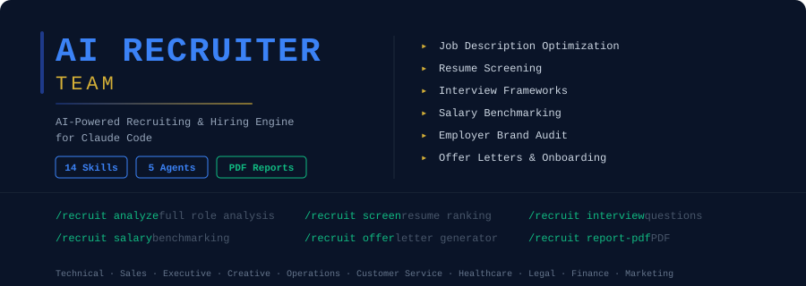

<p align="center">
  
</p>

<p align="center">
  <strong>AI-powered recruiting and hiring engine</strong> for Claude Code.<br/>
  Analyze any role, screen resumes, generate interview kits, benchmark salary, draft offers — and produce a client-ready PDF report in minutes.
</p>

<p align="center">
  <a href="#quick-start"></a>
  
  
  
  
</p>

---

## ⭐ Why This Exists

Recruiting agencies charge **$15,000-$30,000 per placement** (typically 20-25% of the candidate's first-year base salary). Executive search firms charge **30-35%** — often $50K-$200K for a single VP hire. In-house recruiting teams spend **2-3 months** on every senior role, with industry-average costs of $4,000-$8,000 per hire in tooling, time, and missed productivity.

Most of that cost lives in four invisible failures:

1. **Bloated job descriptions** with 10+ "must-haves" that filter out 70% of qualified candidates before they even apply
2. **Unstructured interview loops** where two interviewers ask completely different questions and converge on the loudest voice in the debrief
3. **Comp gaps** where the recruiter doesn't have authority to flex 5-10% — and loses every top candidate to faster, better-prepared competitors
4. **Employer-brand blind spots** where Glassdoor reviews and a stale career site quietly cap the inbound pipeline

The AI Recruiter Team turns Claude Code into a full recruiting agency you can run from the command line. Run a full hiring readiness analysis on any role in 2 minutes and produce a polished, client-ready PDF report with a 90-day improvement plan.

---

## 🚀 What It Does

The AI Recruiter Team launches **5 parallel AI agents** to analyze any role across:

| Agent | Weight | What It Measures |
|-------|--------|------------------|
| **Job Description Quality** | 20% | Clarity, ATS keyword optimization, inclusivity, candidate appeal |
| **Resume Screening Rigor** | 20% | Rubric quality, red flag detection, funnel conversion |
| **Interview Framework** | 20% | Structured design, behavioral coverage, technical assessment, decision speed |
| **Compensation Competitiveness** | 20% | Market alignment, geographic accuracy, total comp completeness |
| **Employer Brand Strength** | 20% | Glassdoor / Indeed, career site, LinkedIn, candidate experience, retention |

It then produces a composite **Hiring Readiness Score (0-100)** with letter grade and a prioritized 90-day action plan.

### Feature Highlights

| Feature | Description |
|---------|-------------|
| **Full Role Analysis** | 5 parallel agents analyze every dimension simultaneously |
| **Hiring Readiness Score** | Weighted composite 0-100 with A+ to F grade and signal |
| **Resume Screening** | Score and rank candidates 0-100 with hire/pass/skip recommendation |
| **Deep Candidate Scoring** | 5-dimension evaluation with hire/no-hire signal |
| **Interview Question Generator** | 40-60 questions across behavioral, technical, culture, situational |
| **Personalized Outreach** | LinkedIn InMail, cold email, follow-up sequences |
| **Salary Benchmarking** | 25th/50th/75th/90th percentile bands by location + total comp |
| **Offer Letters** | Standard template + verbal offer script + close plan |
| **30/60/90 Onboarding** | Day 1 readiness, milestone checkpoints, evaluation criteria |
| **Pipeline Operations** | Funnel health, bottleneck detection, aging candidate alerts |
| **Candidate Comparison** | Head-to-head with tiebreaker analysis |
| **Employer Brand Audit** | Glassdoor / Indeed / career site / competitor analysis |
| **PDF Reports** | Professional 10-page reports with score gauge, charts, action plan |

---

## Quick Start

### One-Command Install (macOS / Linux)

```bash
curl -fsSL https://raw.githubusercontent.com/mohit626689/ai-recruiter-claude/main/install.sh | bash
```

### Manual Install

```bash
git clone https://github.com/mohit626689/ai-recruiter-claude.git
cd ai-recruiter-claude
./install.sh
```

### Requirements

- Python 3.8+
- Claude Code CLI
- Git
- `reportlab` (installed automatically)

---

## Commands

Open Claude Code and use these commands:

| Command | What It Does | Output |
|---------|--------------|--------|
| `/recruit analyze <role>` | Full role analysis (5 parallel agents) | `RECRUIT-ANALYSIS-*.md` |
| `/recruit quick <role>` | 60-second role snapshot | Terminal output |
| `/recruit job <description>` | Optimize/rewrite job description | `RECRUIT-JOB-*.md` |
| `/recruit screen <resumes>` | Batch resume screening & ranking | `RECRUIT-SCREEN-*.md` |
| `/recruit score <candidate>` | Deep single-candidate scoring | `RECRUIT-SCORE-*.md` |
| `/recruit interview <role>` | Generate interview question sets | `RECRUIT-INTERVIEW-*.md` |
| `/recruit outreach <candidate>` | Personalized recruiting outreach | `RECRUIT-OUTREACH-*.md` |
| `/recruit salary <role>` | Salary benchmarking & negotiation prep | `RECRUIT-SALARY-*.md` |
| `/recruit offer <candidate>` | Generate offer letter + verbal script | `RECRUIT-OFFER-*.md` |
| `/recruit onboard <hire>` | 30/60/90 day onboarding plan | `RECRUIT-ONBOARD-*.md` |
| `/recruit pipeline` | Full hiring pipeline report | `RECRUIT-PIPELINE.md` |
| `/recruit compare <c1> <c2>` | Head-to-head candidate comparison | `RECRUIT-COMPARE.md` |
| `/recruit employer <company>` | Employer brand audit | `RECRUIT-EMPLOYER-*.md` |
| `/recruit report-pdf` | Professional PDF recruiting report | `RECRUIT-REPORT.pdf` |

---

## 🤖 How It Works — The 5 Parallel Agents

When you run `/recruit analyze <role>`, the orchestrator:

1. **Phase 1 — Role Discovery (20-30s):** Captures role profile (title, level, function, location, comp band, hiring manager, urgency). Detects role type for tailored analysis.

2. **Phase 2 — Launch 5 Parallel Agents (60-90s):**
   - **recruit-job** — Analyzes JD for ATS, inclusivity, must-haves, appeal; produces rewrite recommendations
   - **recruit-screen** — Evaluates screening rigor, funnel conversion, red flag detection
   - **recruit-interview** — Audits loop structure, generates 40-60 calibrated questions with rubrics
   - **recruit-salary** — Pulls market data (Levels.fyi, Glassdoor, BLS), builds percentile bands and geographic adjustments
   - **recruit-employer** — Audits Glassdoor, Indeed, LinkedIn, career site, candidate experience signals

3. **Phase 3 — Synthesis (20-30s):** Computes composite Hiring Readiness Score, generates 90-day action plan, projects time-to-fill improvement.

Total runtime: **2-3 minutes** for a complete analysis.

---

## Scoring Methodology

The **Hiring Readiness Score (0-100)** is a weighted composite:

| Category | Weight | What It Measures |
|----------|--------|------------------|
| Job Description Quality | 20% | Clarity, ATS, inclusivity, must-haves, appeal |
| Resume Screening Rigor | 20% | Rubric, red flags, response time, funnel |
| Interview Framework | 20% | Structure, behavioral coverage, technical, decision speed |
| Compensation Competitiveness | 20% | Market percentile, geographic, total comp |
| Employer Brand Strength | 20% | Reviews, career site, candidate experience, retention |

### Grade & Signal

| Score | Grade | Signal |
|-------|-------|--------|
| 85-100 | A+ | **Ready to hire** — process is dialed in |
| 70-84 | A | **Strong** — minor refinements needed |
| 55-69 | B | **Average** — significant improvements possible |
| 40-54 | C | **Below Average** — losing top candidates |
| 25-39 | D | **Poor** — failed hires likely |
| 0-24 | F | **Critical** — overhaul process before hiring |

---

## Role Types Supported

| Role Type | Key Analysis Focus |
|-----------|--------------------|
| **Technical / Engineering** | Take-home work sample, system design, GitHub presence, equity story |
| **Sales** | Quota verification, OTE clarity, ride-along, reference depth |
| **Executive (VP+)** | Confidentiality, board references, executive search dynamics |
| **Creative (Design / Marketing)** | Portfolio review, taste alignment, brand-stage fit |
| **Operations / Admin** | Software proficiency, process design, attention to detail |
| **Customer Service / Support** | Communication, role-play, tone, language requirements |
| **Healthcare / Legal / Regulated** | License verification, certification check, compliance background |

---

## 🎯 Use Cases

### In-House Recruiting Team
- Audit every open role in 3 minutes before posting
- Generate interview kits standardized across all interviewers
- Run candidate debriefs with structured evidence
- Track pipeline health and surface bottlenecks weekly
- Replace expensive Lever / Greenhouse plugins with command-line tooling

### Executive Search Firms
- Conduct deep candidate scoring on every finalist
- Build employer brand audits as part of the search proposal
- Run head-to-head comparisons when client is deciding between two finalists
- Generate PDF reports that justify retainer fees ($100K+ for VP searches)
- Compete with bulge-bracket firms (Heidrick, Korn Ferry) on speed and depth

### Staffing Agencies
- Screen 50+ resumes per role in minutes
- Personalize LinkedIn outreach at scale without spam
- Benchmark salary across geographies for client conversations
- Produce client-ready audits for every open req
- Charge $2-$5K per placement for SMB clients (vs. 20% of salary)

### Freelance Recruiters
- Onboard new clients with a comprehensive audit (replaces 2 weeks of manual research)
- Generate deliverables that justify retainer fees
- Run candidate scoring on every loop
- Use as a sales tool: "Here's a free audit. Here's what we'd do differently."

### Hiring Managers Doing Their Own Search
- Get a structured interview kit without hiring a recruiter
- Benchmark salary before posting
- Audit your own JD before publishing
- Score finalists with evidence (not gut feel)

---

## 📊 Example Output

```
/recruit quick Senior Backend Engineer San Francisco

============================================================
  ROLE SNAPSHOT | May 20, 2026
  Senior Backend Engineer — San Francisco / Remote-US
============================================================

  Function:    Engineering           Level:    IC5 (Senior)
  Salary:      $170K-$200K base
  Urgency:     Growth (not blocking)
  Type:        Remote-US (national band)

------------------------------------------------------------
  HIRING DIFFICULTY: HARD — Hot market, comp gap vs Big Tech
------------------------------------------------------------

  Dimension              Rating
  ---------              ------
  Market Demand          High — backend ICs in high demand 2026
  Salary Alignment       Below — 12% below 75th percentile in SF
  Sourcing Difficulty    Avg — passive candidates require outbound
  Competition Level      Heavy — top candidates have 3-5 offers
  Time-to-Hire Risk      Slow — current process 70 days median

------------------------------------------------------------
  TOP 3 PRIORITY ACTIONS
------------------------------------------------------------
  1. Add equity refresh policy (20% of initial at year 3) —
     biggest comp objection in close calls
  2. Post explicit salary band $170-$220K — legally required
     in CA/CO/NY/WA + increases apps 30%
  3. Cut interview loop from 5 weeks to 2-3 weeks — top
     candidates accept other offers within 7-10 days

------------------------------------------------------------
  TIME-TO-HIRE
------------------------------------------------------------
  Realistic days-to-close: 45-60 days (vs current 70+)

------------------------------------------------------------
  VERDICT: Strong fundamentals but losing closes to faster,
  better-paying competitors. 90-day fixes available.
------------------------------------------------------------

  Want the full analysis? Run: /recruit analyze Senior Backend Engineer
============================================================
```

---

## Project Structure

```
ai-recruiter-claude/
├── recruit/                          # Main skill orchestrator
│   └── SKILL.md
├── skills/                           # 14 sub-skills
│   ├── recruit-analyze/              # Full analysis (5 parallel agents)
│   ├── recruit-quick/                # 60-second snapshot
│   ├── recruit-job/                  # JD optimization
│   ├── recruit-screen/               # Batch resume screening
│   ├── recruit-score/                # Deep candidate scoring
│   ├── recruit-interview/            # Interview question generator
│   ├── recruit-outreach/             # Personalized outreach
│   ├── recruit-salary/               # Salary benchmarking
│   ├── recruit-offer/                # Offer letter generator
│   ├── recruit-onboard/              # 30/60/90 onboarding plan
│   ├── recruit-pipeline/             # Pipeline operations report
│   ├── recruit-compare/              # Head-to-head candidate comparison
│   ├── recruit-employer/             # Employer brand audit
│   └── recruit-report-pdf/           # PDF report generation
├── agents/                           # 5 parallel subagents
│   ├── recruit-job.md
│   ├── recruit-screen.md
│   ├── recruit-interview.md
│   ├── recruit-salary.md
│   └── recruit-employer.md
├── scripts/
│   └── generate_recruit_pdf.py       # PDF report generator (ReportLab)
├── install.sh
├── uninstall.sh
├── requirements.txt
└── README.md
```

---

## PDF Reports

Generate professional 10-page hiring readiness reports with:

- **Cover page** with Hiring Readiness Score gauge (color-coded 0-100)
- **Score dashboard** with bar chart and category breakdown
- **Job description analysis** with ATS keywords, inclusivity flags, rewrite recs
- **Candidate pipeline summary** with funnel chart and top candidate table
- **Interview framework** with recommended loop and sample questions
- **Salary benchmarks** with percentile bands and geographic adjustments
- **Offer details** with package, timeline, and decline risk assessment
- **Employer brand assessment** with reviews, career site, competitors
- **90-day action plan** with Week 1 / Days 8-30 / Days 31-90 phases
- **30/60/90 onboarding plan** with milestones and evaluation criteria

Color scheme: Royal blue (#1e3a8a), Gold (#d4af37), Success green (#10b981)

```bash
# Generate a sample PDF report
python3 ~/.claude/skills/recruit/scripts/generate_recruit_pdf.py --demo
```

---

## 💼 Want to Sell This as a Service?

Recruiting agencies charge $15,000-$30,000 per placement. Executive search firms charge 30-35% of first-year base. This tool produces the deliverables that justify those fees.

### Productized Service Pricing

| Package | What's Included | Recommended Price |
|---------|------------------|-------------------|
| **One-Time Audit** | Full audit + PDF report + 30-min walkthrough call | $497-$997 |
| **Per-Placement (SMB)** | Sourcing + screening + interview support + offer close | $2,000-$5,000 per placement |
| **Per-Placement (Mid-Market)** | Above + employer brand work + 30/60/90 plan | $5,000-$15,000 per placement |
| **Monthly Retainer** | 1-2 active reqs + pipeline ops + weekly debriefs | $1,500/mo |
| **Growth Retainer** | 3-5 active reqs + employer brand + content | $3,500-$5,000/mo |
| **Executive Search** | VP+ retained search (research, sourcing, interviewing, offer) | $25,000-$75,000 per search |
| **Multi-Role / Burst Hiring** | 10+ roles in 90 days (Series B-C growth-stage) | $25,000-$75,000 project fee |

### Where to Find Clients

1. **Startups raising Series A-B** — they need to hire 10-20 people fast and don't have an in-house recruiting team
2. **Mid-market companies with broken funnels** — apply the funnel-conversion analysis to their LinkedIn / Indeed presence
3. **Companies post-layoff trying to rebuild trust** — your employer-brand audit is a sales wedge
4. **Hiring managers without recruiters** — the audit + interview kit alone is a complete service
5. **VC portfolio support** — most VCs have a "talent partner" role; pitch your service to them
6. **HR consulting firms** — partner to deliver the AI-powered layer

### Sales Conversion Tips

- Lead with the **time-to-hire number** ("I found 25 days you could shave off your average req")
- Show the **PDF report on the call** — it justifies the price
- Offer a **paid audit first** ($497-$997) — converts at 30-50% to retainer
- For the placement close, position retainer or per-placement based on volume (1-2 hires/quarter = retainer; ad-hoc = per-placement)

**Average recruiting agency revenue per client: $30,000-$120,000/year.** Five clients = a real business.

[Join the AI Workshop community to learn the full playbook](https://skool.com/aiworkshop)

---

## 🔗 Related Tools

Built by the same author — all share the same Claude Code skill architecture:

- [ai-marketing-claude](https://github.com/mohit626689/ai-marketing-claude) — Full marketing strategy & content
- [ai-sales-team-claude](https://github.com/mohit626689/ai-sales-team-claude) — Prospect research & sales prep
- [ai-legal-claude](https://github.com/mohit626689/ai-legal-claude) — Contract review & legal docs
- [ai-reputation-claude](https://github.com/mohit626689/ai-reputation-claude) — Reputation management for any business
- [ai-restaurant-claude](https://github.com/mohit626689/ai-restaurant-claude) — Restaurant marketing & operations
- [ai-realestate-claude](https://github.com/mohit626689/ai-realestate-claude) — Property research & investment analysis
- [ai-finance-claude](https://github.com/mohit626689/ai-finance-claude) — Personal finance & retirement planning
- [geo-seo-claude](https://github.com/mohit626689/geo-seo-claude) — GEO + SEO audit for websites
- [ai-trading-claude](https://github.com/mohit626689/ai-trading-claude) — Stock & options analysis
- [ai-crypto-claude](https://github.com/mohit626689/ai-crypto-claude) — Cryptocurrency analysis
- [ai-ads-claude](https://github.com/mohit626689/ai-ads-claude) — Paid ads strategist

---

## Contributing

1. Fork the repository
2. Create your feature branch (`git checkout -b feature/new-skill`)
3. Commit your changes (`git commit -m 'Add new skill'`)
4. Push to the branch (`git push origin feature/new-skill`)
5. Open a Pull Request

---

## License

MIT License. See [LICENSE](LICENSE) for details.

---

## Disclaimer

This tool is for **educational and research purposes only**. All audit findings, scores, and recommendations are AI-generated approximations based on publicly available data and provided role context. Recruiting is a highly regulated activity — recommendations must be validated by HR and employment counsel before implementation. Job descriptions, interview questions, offer letters, and screening criteria all carry EEOC and state-specific legal risk. The authors accept no liability for any losses incurred from reliance on this report.

Always verify:
- EEOC and applicable employment law in your jurisdiction
- Pay-transparency requirements (CA, CO, NY, WA, and increasingly nationwide)
- Background check / reference check process compliance (FCRA in U.S.)
- State-specific offer-letter requirements (CA has unique terms)
- Visa / right-to-work compliance for non-citizen candidates
- ADA accommodation requirements throughout the loop

---

<p align="center">
  Built for <a href="https://claude.com/claude-code">Claude Code</a>
</p>
